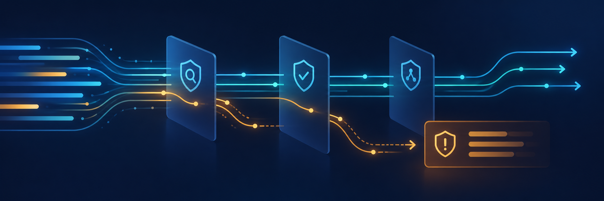

# Laravel Content Sentinel



A configurable pipeline for checking user or AI generated content before you
save or publish it.

[](https://github.com/eloquage/laravel-content-sentinel/actions/workflows/run-tests.yml)
[](https://packagist.org/packages/illuma-law/laravel-content-sentinel)
[](LICENSE)

Requires PHP 8.3+, Laravel 11–13, Filament Support 4 or 5, and Spatie Laravel
Model States 2.10+.

## Install

```bash
composer require illuma-law/laravel-content-sentinel
php artisan vendor:publish --tag=content-sentinel-config
```

The published config selects the gates and their settings. Built-in gates check
prohibited phrases, brand voice, duplicate content, sensitive topics, and
claims with a fact checker.

## Check content

```php
use IllumaLaw\ContentSentinel\DTOs\SentinelPayload;
use IllumaLaw\ContentSentinel\Facades\ContentSentinel;

$result = ContentSentinel::check(new SentinelPayload(
    content: 'Our product is guaranteed to work!',
    title: 'Product launch',
    metadata: ['author_id' => 123],
));

if ($result->hasBlocks()) {
    abort(422, 'This content cannot be published.');
}

if ($result->hasWarnings()) {
    logger()->warning('Content needs review', $result->warnings);
}

// Save or publish the content.
```

Blocked content should be stopped by your application. Warnings are returned
for your application to send to a moderation queue or reviewer.

## Test

```bash
composer test
composer analyse
vendor/bin/pint --test
```

MIT licensed. See [LICENSE](LICENSE).
